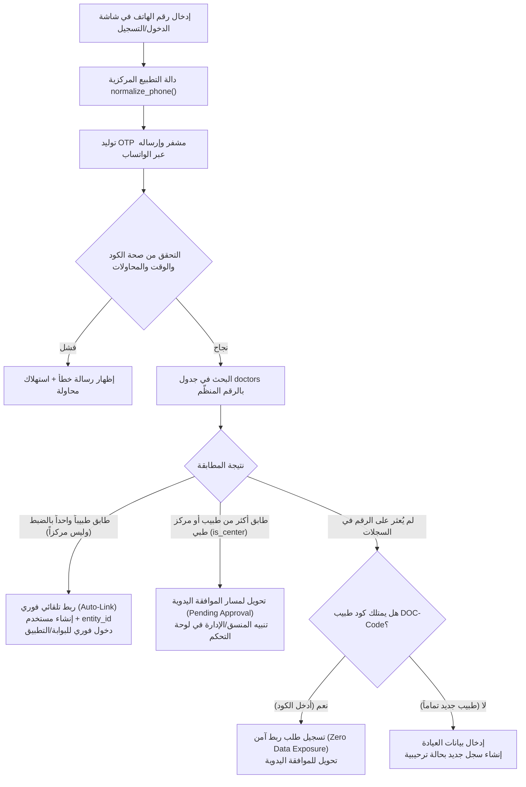
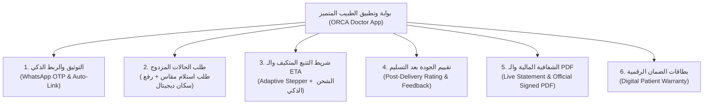
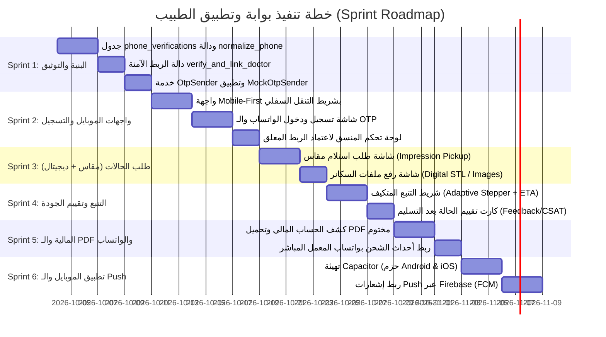

# وثيقة الخطة الرئيسية المحدثة لتطوير بوابة وتطبيق الطبيب (Doctor Portal & Mobile App)
## ORCA Dental Lab ERP — Doctor Portal, Logistics & Identity Linking Master Plan (v2.0)

## القرار التشغيلي الحالي — 7 أكتوبر 2026: كلمة المرور والدعوات (يتقدم على وصف OTP أدناه)

- بناءً على قرار صاحب المشروع، نؤجل تفعيل Meta / WhatsApp OTP إلى مرحلة لاحقة؛ حساب ورقم واتساب المعمل غير متاحين للإعداد حاليًا.
- الطبيب يسجل رقم الموبايل والإيميل وكلمة مرور وتأكيدها، ثم الاسم العربي الثنائي والعنوان والمنطقة وبيانات المركز والفروع. كلمة المرور لا تقل عن 8 أحرف، وتخزن كبصمة bcrypt بمعامل 10 داخل Auth فقط؛ لا يراها المعمل أو تحفظ في بيانات التسجيل.
- **الجديد:** ينشأ الطبيب/المركز والفروع والأطباء التابعون بالكود الجغرافي المعتمد ويدخل مباشرة، دون انتظار موافقة. إذا طابق الهاتف سجلًا قائمًا يمنع إنشاء سجل مكرر ويُطلب مسار «سبق التعامل».
- **القديم بدعوة المعمل:** يصدر الموظف المصرح له رابطًا من صفحة الطبيب، ويرسله يدويًا لصاحبه. الدعوة تخص سجلًا واحدًا، تنتهي بعد 7 أيام، وتستهلك مرة واحدة؛ التسجيل يفعّل الحساب ويربطه مباشرة بالسجل مع حفظ الكود والحالات والمالية؛ أرقام التواصل والفروع الإضافية تحفظ عند التسجيل، والعنوان الرئيسي لا يتغير إلا بطلب يراجعه المعمل. إعادة إصدار الدعوة تبطل السابقة.
- **القديم دون دعوة:** يختار «سبق التعامل»، ويبحث بالهاتف ليظهر الاسم والعنوان والفروع المسجلة لتعبئة بيانات العيادة. يختار سجله ويكمل البيانات وكلمة المرور؛ المعمل يراجع الربط. إن لم يظهر السجل يمكن إرسال طلب يدوي. الطلب المعلق لا يحصل على جلسة أو حالات أو مالية؛ بعد الاعتماد يستخدم كلمة المرور التي اختارها دون جهاز خاص أو إعادة تسجيل.
- الدخول بالإيميل أو الموبايل + كلمة المرور من أي جهاز. الموبايل اسم دخول غير متحقق من ملكيته؛ لا يثبت وحده حق الوصول لسجل قديم. يحل الموبايل إلى إيميل حسابه **بعد صحة كلمة المرور فقط**، ثم ينشئ Supabase الجلسة الاعتيادية؛ لا نحتاج SMS provider أو إرسال OTP لهذا المسار.
- استعادة كلمة المرور حاليًا عبر مسؤول المعمل بعد مراجعة الهوية، باستخدام إدارة المستخدمين. لا عرض لكلمة المرور الحالية. إضافة الاستعادة الذاتية تحتاج إعداد قناة موثوقة والتحقق من ملكيتها.
- المسار الافتراضي `password`؛ مسار الجهاز المؤقت متوقف ومنعت وظائف فتحه من عملاء المتصفح مع حفظ سجلاته للمراجعة. `VITE_DOCTOR_ACCESS_MODE=otp` يحفظ تجربة OTP المحلية فقط ولا يفعّل واتساب في الإنتاج.
- لاحقًا: Meta Cloud API + قالب Authentication + Supabase Phone Auth/Send SMS Hook لإثبات ملكية الهاتف واستعادة الدخول، مع الحفاظ على هوية الحساب وربط الطبيب. لا نعتمد على تاريخ تأكيد الإيميل الإداري كإثبات ملكية؛ بيانات Auth تسجل `unverified_password` والهاتف غير مؤكد.
- قبل النشر: مراجعة migrations الجديدة على بيئة الاختبار، تعطيل **Allow new users to sign up** في Supabase Auth لمنع تجاوز مسار التسجيل المراجع، مع إبقاء تسجيل الدخول بالإيميل/كلمة المرور مفعلًا. إضافة طاقم المعمل تستعمل وظائف admin الآمنة بدل التسجيل العام، ولا تتعطل بهذا الإعداد. يلزم HTTPS وحماية الطلبات الآلية/حدود IP على بوابة API. لا تعديل إنتاج أو مالية تلقائيًا من جلسة التطوير.


## تحديث التسجيل وبيانات العيادة — 11 أكتوبر 2026

- البحث بالصيغة المحلية `01098484811` يطابق الأرقام المحلية أو الدولية ذات المسافات أو أرقام Excel بدون الصفر. أرقام التواصل الإضافية والفروع تدخل في البحث أيضًا؛ الربط بالسجلات القديمة ما زال يحتاج دعوة أو اعتماد المعمل.
- كلمة المرور 8 أحرف على الأقل؛ الملاحظة تحت الحقل الأول، وإعادة الإدخال تحت التأكيد، وزر إظهار/إخفاء لكل حقل. رسالة البحث: «سيتم تأكيد الربط بعد مراجعة المعمل».
- العنوان الرئيسي والفروع القديمة تظهر جاهزة. لا تعديل مباشر للعنوان الرئيسي؛ يكتب الطبيب العنوان المقترح في «طلب تعديل». للمعمل اعتماد الربط وحده وترك العنوان للمراجعة، أو اعتماد التعديل معه صراحةً. طلبات تغيير عنوان الحسابات المدعوة تظهر في نفس قائمة المراجعة.
- لكل رقم: صاحب الرقم (الطبيب، السكرتارية، واتساب فقط، طبيب آخر باسمه) ووجود واتساب. يسمح بإضافة أرقام تواصل، ويطلب رقم لكل فرع جديد، بما فيها أرقام العيادة الأرضية. بيانات واتساب إقرار من الطبيب، وليست إثبات ملكية للرقم.
- migration: `20261011000000_doctor_registration_contacts_and_address_review.sql`؛ يضيف بيانات التواصل وقائمة مراجعة العناوين. لا يعيد ترقيم الأطباء ولا يعدل أي بيانات مالية. التحقق والنشر المحلي على قاعدة QA المنفصلة؛ يحتاج تطبيق migration قبل نشر الواجهة على الموقع الفعلي.

---

## 1. ملخص تنفيذي والأهداف الاستراتيجية (Executive Summary)

تهدف هذه الخطة إلى تحويل تجربة الطبيب في معمل **ORCA Dental Lab** من نمط التواصل اليدوي والتقليدي عبر المكالمات الهاتفية أو رسائل الواتساب المتفرقة، إلى **بوابة رقمية تفاعلية حديثة (Doctor Portal)** وتطبيق موبايل متكامل (**Mobile App**) يُحدث نقلة نوعية في خدمة العملاء ويُشكل **ميزة تنافسية كبرى للمعمل في السوق**.

### السياق التشغيلي ومحددات المشروع الحالية:
1. **افتتاح المعمل الداخلي (خلال أسبوعين)**:
   - النظام حالياً يعمل بمسار القياس والتنسيق الخارجي (`orders.production_status`).
   - خلال أسبوعين سيتم تفعيل خطوط الإنتاج الداخلي (`production_v1 = 'on'`)، بما يشمل مراحل التصنيع (CAD/CAM/Ceramic)، مهام الفنيين (`my_tasks`)، ومنظومة الطرود والشحن (`shipments`).
   - **القرار المعماري**: تصميم شريط تتبع الحالات (Production Stepper) ليعمل بنمط التكيف الموحد (**Adaptive Unified Stepper**) ليعكس مسار العمل الحالي فوراً، ويرتبط تلقائياً بمراحل المعمل الداخلي فور افتتاحه دون الحاجة لتعديل الواجهات.
2. **طبيعة منظومة الشحن (3rd-Party Courier Logistics)**:
   - المعمل يتعامل مع شركات شحن وتوصيل خارجية، وبالتالي لا يمكن ربط الحالة بهاتف شخصي لمندوب متغير.
   - **الحل التشغيلي**: يظهر للطبيب بوضوح *«الحالة خرجت للشحن وفي طريقها للعيادة»*، مع زر اتصال فوري ومباشر مع **واتساب خدمة عملاء معمل ORCA** مزوداً برسالة آلية مجهزة برقم الحالة واسم المريض لتلقي أي استفسار وتتبعه مركزياً.
3. **منظومة استلام الحالات المزدوجة (Dual Case Intake)**:
   - **مسار المقاس الفيزيائي (Impression Pickup)**: يطلب الطبيب مندوب الشحن لاستلام مقاس/طبعة من العيادة مع تسجيل بيانات الحالة وموعد الجاهزية بنقرة واحدة.
   - **مسار الديجيتال (Digital Scans)**: رفع مباشر لملفات الماسح الفموي (STL / PLY) وصور الحالة واللون.
4. **منظومة تقييم الجودة التفاعلية (Post-Delivery Rating & CSAT)**:
   - سؤال الطبيب تفاعلياً عن جودة الحالة ومدى رضاه فور تسليمها بالعيادة، مع تسجيل التقييم في جدول [`doctor_order_feedback`](file:///d:/dental-lab-erp/supabase/migrations/20260808000000_order_issue_workflow_v2.sql#L155) عبر الإجراء الآمن [`submit_my_order_feedback_v2`](file:///d:/dental-lab-erp/supabase/migrations/20260808000000_order_issue_workflow_v2.sql#L955).
5. **التحويل لتطبيق موبايل (Capacitor + Push Notifications)**:
   - بناء الواجهات من اليوم الأول بنمط **Mobile-First** مع شريط تنقل سفلي (Bottom Navigation Bar).
   - استغلال حزمة **CapacitorJS** لتحويل نفس كود React 19 إلى تطبيق Native للأندرويد والـ iOS مع تفعيل **Push Notifications** الحقيقية عبر Firebase Cloud Messaging (FCM).

---

## 2. نتائج التدقيق الحي لقاعدة البيانات (Live Database Audit Findings)

تم إجراء تدقيق فعلي وقراءة مباشرة لسجلات جدول الأطباء (`doctors`) على قاعدة البيانات الحية للنظام، وشمل الفحص **188 طبيباً مسجلاً**:

### أ. توزيع أرقام الهواتف وتحليل الجودة:
| الفئة في قاعدة البيانات | العدد | النسبة | التوصيف البرمجي والتشغيلي |
| :--- | :---: | :---: | :--- |
| **أرقام مصرية قياسية (11 رقم)** | 99 | 52.7% | تبدأ بـ `010 / 011 / 012 / 015`، صالحة للتطبيع المباشر. |
| **أرقام قياسية بكود الدولة (12 رقم)** | 9 | 4.8% | تبدأ بـ `201...`، جاهزة للإرسال الدولي والمحلي. |
| **أرقام مسترجعة من Excel (10 أرقام)** | **56** | **29.8%** | **اكتشاف تقني جوهري**: 56 رقماً أكل برنامج الإكسل الصفر الأيسر منها فخُزنت كـ `10... / 11... / 12... / 15...`. |
| **أرقام وهمية أو خانات أصفار (Dummy data)** | 11 | 5.9% | مسجلة بـ `000` أو `0000` أو `00000` لحالات أُدخلت بدون هاتف الطبيب. |
| **أرقام دولية حقيقية (خارج مصر)** | 4 | 2.1% | عملاء دوليون للمعمل (السعودية `+966`، سوريا `+963`، اليمن `+967`). |
| **أخطاء إدخال كتابية (Typo Digits)** | 4 | 2.1% | أرقام غير قياسية (مثل 12 رقم يبدأ بـ `010165256893` أو 9 أرقام ناقصة). |
| **نصوص بدلاً من الأرقام** | 4 | 2.1% | خانات مسجل بها نصوص مثل "غير محدد" أو اسم المركز "بيبودنت". |
| **أطباء مربوطون حالياً بحساب مستخدم** | 0 | 0.0% | لا يوجد حالياً أي مستخدم مسجل بدور `doctor` مربوط بـ `entity_id`. |

### ب. حالات التكرار والتشابك (Duplicate & Center Analysis):
1. **تعدد الفروع والعيادات لنفس الطبيب**:
   - مثال: الطبيب "محمود عبد الهادي" مسجل بسجلين مختلفين ("كمفورت د محمود عبدالهادى" كود 2013، و"تاج د محمود عبدالهادى" كود 2012) وكلاهما يحملان نفس الرقم `1014373270`.
2. **اشتراك المركز الطبي مع طبيب تابع له**:
   - مثال: "مركز بيبودنت" (كود 1042) يشترك في الرقم `01000275533` مع الدكتورة "هبه الضوي" (كود 1042-103).
3. **أطباء بكودين مستقلين**:
   - مثال: "د. محمد سالم" مسجل بكود (1019-811) وكود مستقل (1040) بنفس رقم الموبايل.

### الأثر المعماري للنتائج:
> [!IMPORTANT]
> معالجة حالة الـ 10 أرقام (Excel Stripped Zero) داخل دالة التطبيع المركزية ترفع نسبة الأطباء المؤهلين للمطابقة التلقائية الفورية من **57.5% إلى 87.2%** (164 طبيباً من أصل 188)، بينما تذهب الـ 12.8% المتبقية بأمان كامل لمسار المراجعة والموافقة اليدوية لحماية بياناتهم.

---

## 3. محرك التطبيع والمطابقة الآمنة (Normalization & Strict Matching Engine)



### أ. خوارزمية التطبيع الموحدة (`normalize_phone`):
تقوم الدالة بتنظيف المدخلات وتطبيق القواعد التالية وفق معيار E.164:
1. إزالة جميع المسافات، الفواصل، والرموز الخاصة (`-`, `+`, `/`, `\`).
2. تحويل الأرقام العربية الهندية (`٠-٩`) إلى أرقام لاتينية (`0-9`).
3. إذا بدأ الرقم بـ `+` أو `00`، تُزال البادئة.
4. **الأرقام المصرية (EG - +20)**:
   - إذا كان 11 رقماً ويبدأ بـ `01[0125]`: يُحذف الصفر ويُضاف كود الدولة ليصبح `201[0125]XXXXXXXX`.
   - إذا كان 10 أرقام ويبدأ بـ `1[0125]` (حالة الإكسل): يُضاف كود الدولة مباشرة ليصبح `201[0125]XXXXXXXX`.
   - إذا كان 12 رقماً ويبدأ بـ `201[0125]`: يبقى كما هو `201[0125]XXXXXXXX`.
5. **الأرقام الدولية**:
   - إذا طابق بادئات دولية صحيحة (مثل السعودية `9665...`، سوريا `963...`، اليمن `967...`) بطول 11-14 رقماً: يُعتمد كرقم دولي صالح.
6. **ما دون ذلك**: يُصنف كـ `INVALID` ويُمنع من الإرسال الأوتوماتيكي.

### ب. شروط الربط التلقائي الصارم (Strict 1-to-1 Match):
يتم ربط حساب الطبيب تلقائياً ودون تدخل بشري فقط وفقط إذا تحققت الشروط الأربعة مجتمعة:
1. **التفرد المطلق**: الرقم المنظّم يطابق **سجلاً واحداً فقط** في `doctors.phone` أو `doctors.phone2`.
2. **ليس مركزاً طبياً**: الحقل `is_center = false`، حيث المراكز تتطلب اختيار الفرع أو الحساب المناسب.
3. **ليس طبيباً تابعاً لمركز**: الحقل `parent_id IS NULL`.
4. **غير مربوط مسبقاً**: لا يوجد مستخدم نشط في جدول `users` يحمل هذا الـ `entity_id`.

---

## 4. منظومة التوثيق والـ OTP بالواتساب (WhatsApp Auth Architecture)

### أ. تصميم الـ Interface ومبدأ عزل المزود (Dependency Inversion):
لمنع تعطيل المشروع أثناء انتظار مراجعة وتوثيق Meta Business Verification واعتماد قوالب الرسائل، يتم بناء طبقة التجريد:

```typescript
export interface OtpSendResult {
    success: boolean;
    messageId?: string;
    channel: 'whatsapp' | 'sms' | 'mock';
    error?: string;
}

export interface OtpSender {
    sendOtp(phone: string, code: string): Promise<OtpSendResult>;
}
```

1. **`MockOtpSender` (بيئة التطوير والاختبار المحلي)**:
   - يطبع الكود في الـ Console، ويسجله في جدول التحقق لاختبار الواجهات بالكامل فوراً.
2. **`MetaCloudOtpSender` (بيئة الإنتاج الرسمية)**:
   - يستخدم **WhatsApp Business Cloud API** الرسمي المباشر من Meta.
   - يعتمد قالباً معتمداً من فئة `AUTHENTICATION` مع كود أمان ذي صلاحية مؤقتة وزر نسخ فوري (Copy Code Button).
3. **`SmsFallbackSender` (الخطة البديلة للطوارئ)**:
   - في حال تعثر إرسال الواتساب (خلل في شبكة ميتا، عدم وجود إنترنت لدى الطبيب)، يتم التحويل تلقائياً لبوابة رسائل SMS محلية (مثل SMS Misr أو Twilio).

### ب. أمان كود التحقق (OTP Cryptographic Storage):
- يُخزن الكود في جدول `phone_verifications` كـ **HMAC-SHA256** مع مفتاح سري خاص بالخادم (Server Salt)، ولا يُخزن كنص صريح أبداً.
- مدة صلاحية الكود: **5 دقائق** فقط.
- الحد الأقصى لمحاولات الإدخال: **3 محاولات خاطئة** ثم يُحرق الرمز (Invalidated).
- معدل الإرسال (Rate Limiting): حد أقصى **3 طلبات OTP في الساعة** لنفس رقم الهاتف والـ IP.

---

## 5. هيكلية المراكز والفروع (Centers & Multi-Branch Architecture)

1. **الربط بالكيان الأب (Root Entity Linking)**:
   - في حالة المراكز (`is_center = true`) أو الأطباء متعددي الفروع، يُربط `users.entity_id` بالمعرّف الرئيسي للكيان.
2. **مبدل الفروع في واجهة الطبيب (Branch / Clinic Switcher)**:
   - ترويسة البوابة والتطبيق تتضمن قائمة منسدلة سريعة تمكن الطبيب من التبديل بين:
     - `جميع الفروع (مجمّع)`
     - `فرع التجمع / فرع الشيخ زايد / عيادة د. فلان`
3. **سياسة القراءة والاستعلام (Scoped Views & RLS)**:
   - دوال قراءة الأوردرات تعرض الحالات التي يكون فيها:
     `orders.doctor_id = current_user.entity_id OR orders.doctor_id IN (SELECT id FROM doctors WHERE parent_id = current_user.entity_id)`
   - يتيح ذلك للطبيب متابعة كل فروعه من حساب واحد وكلمة سر/بصمة واحدة، مع الحفاظ الكامل على دقة واستقلال قيود المحاسبة الداخلية لكل فرع.

---

## 6. أركان تجربة الطبيب والمزايا التنافسية (Core Pillars & Competitive Edge)



### تفاصيل الأركان الستة:

#### 1. منظومة التوثيق والربط الذكي (WhatsApp Auth & Identity Linking):
- تسجيل ودخول فوري برقم الواتساب دون الحاجة لحفظ كلمات مرور معقدة.
- تعرف تلقائي على الطبيب وربطه بحسابه وسجلاته السابقة بنسبة 87.2%.
- دعم الدخول بالبصمة (Biometrics: FaceID / Fingerprint) عند استخدام تطبيق الموبايل.

#### 2. منظومة طلب الحالات المزدوجة (Dual Case Intake):
- **طلب استلام مقاس فيزيائي (Physical Impression Pickup)**:
  - نموذج بسيط وسريع يملأ فيه الطبيب اسم المريض، نوع التركيبة، اللون، والتعليمات.
  - تحديد عنوان العيادة وتوقيت جاهزية المقاس للاستلام.
  - نقرة واحدة ترسل إشعاراً فورياً للمنسق لحجز مندوب شركة الشحن.
  - الطبيب يرى في تتبع حالته: *«طلب استلام المقاس مسجل ➔ شركة الشحن مكلفة بالاستلام»*.
- **رفع الحالات الديجيتال (Digital Scans & STL Upload)**:
  - رفع مباشر لملفات الماسح الفموي (STL / PLY) من الهاتف أو الكمبيوتر عبر Supabase Storage (`case-files`).
  - رفع صور الابتسامة واللون بدقة عالية دون ضغط أو فقدان جودة (على عكس شات الواتساب العادي).

#### 3. شريط التتبع المتكيف ومتابعة الشحن (Adaptive Stepper & Smart Logistics):
- **التكيف مع افتتاح المعمل الداخلي بعد أسبوعين**:
  - *خلال الأسبوعين القادمين*: يقرأ من مسار `orders.production_status` المعتمد حالياً.
  - *بعد افتتاح المعمل الداخلي*: يتحول تلقائياً لعرض مراحل الإنتاج الحقيقية:
    *(استلام المقاس في المعمل ➔ التصميم الرقمي CAD ➔ الخرط والطباعة CAM ➔ البورسلين واللمسات الفنية ➔ فحص الجودة والتغليف ➔ خرجت للشحن)*.
- **تحديد موعد التسليم الذكي (Calculated ETA)**:
  - الاستفادة المباشرة من دالة قاعدة البيانات [`estimate_order_delivery_time`](file:///d:/dental-lab-erp/supabase/migrations/20260827004000_production_capacity_and_bottlenecks.sql#L131) التي تحسب زمن التسليم المتوقع بناءً على معيار p80 لخطوات المعمل وتقويم العمل الفعلي!
- **متابعة الشحن والتواصل المركزي**:
  - عند خروج الحالة، تظهر شارة واضحة: *«الحالة خرجت للشحن وفي طريقها لعيادتكم 📦»*.
  - زر مميز: **«تواصل مع معمل ORCA عبر الواتساب»** يفتح محادثة واتساب رسمية مع خدمة عملاء المعمل محملة تلقائياً بنص:
    > *"مرحباً معمل أوركا، أستفسر بخصوص حالة المريض [اسم المريض] كود [#1042] التي خرجت للشحن اليوم."*

#### 4. تقييم الحالات بعد التسليم (Interactive Post-Delivery Rating):
- بمجرد تحول الحالة إلى `final_delivered`، يظهر للطبيب كارت تفاعلي عند فتح التطبيق:
  - تقييم بالنجوم من 1 إلى 5 نجوم.
  - وسوم سريعة بنقرة واحدة (One-Tap Tags):
    - *نقاط القوة*: (إطباق مثالي 👌 · مطابقة تامة للون · حواف دقيقة Margins · التزام ممتاز بالموعد).
    - *نقاط تحتاج تحسين*: (إطباق عالي · نقطة تلامس ضيقة Contact · تعديل لون بسيط).
  - خانة ملاحظات نصية حرة.
- يتم الحفظ عبر دالة [`submit_my_order_feedback_v2`](file:///d:/dental-lab-erp/supabase/migrations/20260808000000_order_issue_workflow_v2.sql#L955) في جدول [`doctor_order_feedback`](file:///d:/dental-lab-erp/supabase/migrations/20260808000000_order_issue_workflow_v2.sql#L155).
- يظهر تقرير رضا الأطباء (CSAT Dashboard) في لوحة الإدارة لمتابعة أي تقييم سلبي وتداركه فوراً.

#### 5. الشفافية المالية وكشف الحساب الرسمي المعتمد (Financial Transparency & Statements):
- بطاقة رصيد بارزة (دائن / مدين).
- كشف تفصيلي يربط كل مبلغ بحالته واسم المريض وتاريخها.
- زر **«تحميل كشف الحساب الرسمي المختوم»** بصيغة PDF عالية الجودة بضغطة زر.
- **التوافق التام**: الاعتماد الكامل على نفس دوال الحسابات المركزية المعتمدة دون أي مساس بالقواعد المحاسبية.

#### 6. بطاقات الضمان الرقمية للمرضى (Digital Patient Warranty Cards):
- إصدار شهادة ضمان رقمية لكل تركيبة نهائية (مثل الزركونيوم والإيماكس) برقم تسلسلي، تحمل اسم عيادة الطبيب وشعار معمل ORCA، يشاركها الطبيب بنقرة واحدة مع مريضه عبر الواتساب كقيمة مضافة للمريض.

---

## 7. استراتيجية تطبيق الموبايل والـ Push Notifications (Capacitor Architecture)

```
[ تصميم الواجهات: Mobile-First بالكامل ]
      │
      ├── React 19 + TailwindCSS + Bottom Navigation Bar
      │
      ▼
[ طبقة التحويل: CapacitorJS Engine ]
      │
      ├── @capacitor/core & @capacitor/cli
      ├── @capacitor/push-notifications (FCM Engine)
      ├── @capacitor/camera (تصوير الأسنان والمقاسات)
      └── @capacitor/biometrics (دخول آمن بالبصمة)
      │
      ▼
[ منصات النشر: Google Play Store + Apple App Store ]
```

### أ. تصميم Mobile-First من اليوم الأول:
- شريط تنقل سفلي أنيق (Bottom Navigation Bar) يحتوي على:
  1. 🏠 **الرئيسية**: نظرة عامة سريعة، الرصيد، الحالات الجارية، وكارت تقييم الحالات المسلمة.
  2. 📦 **حالاتي**: قائمة بالبطاقات الذكية، تصفية حسب الحالة، وشريط التتبع اللحظي.
  3. ➕ **طلب جديد (زر وسطي بارز)**: اختيار فوري بين (طلب استلام مقاس فيزيائي) أو (رفع حالة ديجيتال).
  4. 💳 **حسابي المالي**: الرصيد، كشف الحساب، وتنزيل الـ PDF المختوم.

### ب. منظومة الإشعارات المزدوجة (Dual Notification System):
1. **إشعارات الواتساب الرسمية (WhatsApp Business API)**:
   - رسائل التحقق (OTP).
   - إشعار استلام مقاس جديد بالمعمل.
   - إشعار خروج الحالة للشحن للعيادة.
   - كشف الحساب الدوري.
2. **إشعارات الموبايل اللحظية (Push Notifications عبر FCM)**:
   - تنبيهات خط الإنتاج: *«بدأ تصميم حالة المريض فلان»*.
   - تنبيهات الشحن: *«الحالة خرجت مع شركة الشحن وفي طريقها لعيادتكم»*.
   - تنبيهات التقييم: *«وصلت حالة المريض فلان، كيف تقيم جودتها اليوم؟»*.

---

## 8. خطة التنفيذ المرحلية وجدول المهام (Sprint-by-Sprint Roadmap)



### تفاصيل مهام الـ Sprints:

#### Sprint 1: أساسات قاعدة البيانات ومحرك التوثيق (Database & Core Services)
- [ ] إنشاء مايجريشن إضافة جدول `phone_verifications` مع الفهارس وسياسات RLS المحمية.
- [ ] كتابة دالة `normalize_phone(text)` في PostgreSQL لدعم الأرقام المصرية وحالات الإكسل والدولية.
- [ ] بناء دالة الـ RPC المحمية `verify_and_link_doctor(phone, otp_code)`.
- [ ] إنشاء مجلد الخدمات `src/services/auth/` وتعريف الـ `OtpSender` Interface وتطبيق `MockOtpSender`.

#### Sprint 2: واجهات الطبيب Mobile-First وتسجيل الدخول (Mobile-First UI & Auth)
- [ ] بناء التخطيط العام لبوابة الطبيب مع شريط التنقل السفلي المتجاوب (Bottom Navigation Bar).
- [ ] شاشة تسجيل الدخول برقم الواتساب وإدخال الـ OTP التفاعلي (6 أرقام مع مؤقت تنازلي).
- [ ] لوحة تحكم المنسق لمراجعة واعتماد طلبات الربط المشتركة أو اليدوية بنقرة زر.

#### Sprint 3: مسار طلب الحالات المزدوج (Dual Order Intake)
- [ ] شاشة "طلب استلام مقاس فيزيائي" (اختيار العيادة، موعد الجاهزية، بيانات الحالة الأساسية).
- [ ] شاشة "رفع حالة ديجيتال" (رفع ملفات STL/PLY وصور الظلال عبر `case-files` bucket).
- [ ] ربط الطلبات المستلمة بقائمة الانتظار في المعمل مع إشعار المنسق لترتيب الشحن.

#### Sprint 4: شريط التتبع اللحظي المتكيف ومنظومة التقييم (Adaptive Stepper & Feedback)
- [ ] شريط التتبع المتكيف (يقرأ من النظام الحالي ويدعم مراحل المعمل الداخلي بعد افتتاحه).
- [ ] ربط تاريخ التسليم بالموعد المحسوب إحصائياً عبر `estimate_order_delivery_time`.
- [ ] كارت تقييم الجودة التفاعلي للحالات المسلمة بالعيادة مع حفظ التقييم والوسوم السريعة في `doctor_order_feedback`.
- [ ] زر التواصل المباشر مع واتساب المعمل للاستفسار عن الشحنة برقم الحالة.

#### Sprint 5: كشف الحساب الرسمي المالي وبطاقات الضمان (Finance & Warranty)
- [ ] صفحة كشف الحساب والرصيد المعتمدة بدقة على نفس محرك المحاسبة المركزي.
- [ ] زر تصدير كشف الحساب الرسمي PDF بختم معمل ORCA.
- [ ] مولد بطاقة الضمان الرقمية للمريض لمشاركتها عبر الواتساب.

#### Sprint 6: تحويل النظام لتطبيق موبايل والـ Push Notifications (Capacitor & FCM)
- [ ] تهيئة Capacitor داخل المشروع (`@capacitor/core`, `@capacitor/cli`).
- [ ] إعداد وتفعيل خدمة الإشعارات اللحظية Push Notifications عبر Firebase Cloud Messaging.
- [ ] دعم ميزات الكاميرا لمسح وصور الحالات والدخول بالبصمة.
- [ ] تجهيز ملفات البناء لنظامي Android و iOS.

---

## 9. معايير القبول وضمان الجودة (Acceptance Criteria & Verification)

| المجال | معيار القبول والتحقق | طريقة الفحص |
| :--- | :--- | :--- |
| **دقة الربط** | الطبيب الحالي عند إدخال هاتفه يفتح حسابه وتظهر حالاته ورصيده فوراً دون أي ازدواجية. | تجربة مطابقة عملية على عينات حقيقية من الـ 188 طبيباً. |
| **حالات الـ 10 أرقام** | الأرقام الناقصة صفراً بسبب الإكسل يتم التعرف عليها وربطها بنجاح 100%. | اختبار دالة `normalize_phone` بوحدات فحص برمجية (Unit Tests). |
| **سلامة الحسابات** | عدم تغير أي رقم أو رصيد أو مديونية في حساب أي طبيب قبل أو بعد عملية الربط. | مقارنة تقرير مطابقة الأرصدة (Balance Snapshot) قبل وبعد التشغيل. |
| **طلب استلام المقاس** | تسجيل طلب الاستلام يظهر فوراً في لوحة المنسق لتنسيق بوليصة الشحن مع الشركة. | إنشاء طلب تجريبي ومتابعة انعكاسه في لوحة الإدارة. |
| **تقييم الحالات** | حفظ التقييم بالنجوم والوسوم والملاحظات في جدول `doctor_order_feedback` وظهوره في تقارير الجودة. | تجربة إرسال تقييم لحالة مسلمة وفحص السجل في قاعدة البيانات. |
| **تكيف شريط التتبع** | شريط التتبع يقرأ الحالات الحالية بنجاح، ويكون جاهزاً لعرض مراحل المعمل الداخلي عند تفعيلها. | اختبار عرض حالات من المسار الخارجي وحالات من مسار الخرائط الداخلية. |
| **جاهزية الموبايل** | الواجهات تعمل بنعومة تامة على الهواتف بمختلف مقاساتها مع شريط تنقل سفلي سريع. | فحص المتصفح وأجهزة الاختبار المحمولة. |

---

> **تاريخ التوثيق والتحديث**: 3 أكتوبر 2026  
> **الإصدار**: 2.0 (خطة معتمدة للتنفيذ بعد مراجعة متطلبات الشحن وافتتاح المعمل الداخلي والموبايل والتقييم)  
> **الملف المرجعي في المشروع**: `docs/DOCTOR_PORTAL_MASTER_PLAN_AR.md`
